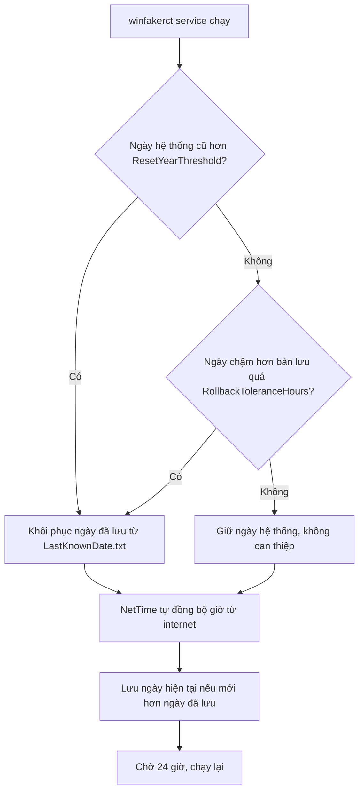

# winfakerct: sửa ngày giờ sai trên laptop Windows cũ

**winfakerct** là "giả đồng hồ phần cứng" cho Windows — tương đương Linux `fake-hwclock`. Khi pin CMOS/BIOS hết hoặc mất điện làm đồng hồ reset về ngày cũ (ví dụ 2019), winfakerct khôi phục ngày đã lưu lần trước khi máy khởi động, sau đó NetTime sẽ tự đồng bộ giờ chính xác từ internet.

Nói đơn giản: máy tính bạn cứ quên ngày. winfakerct nhớ lại cho bạn.

**Không phải là NTP client:** winfakerct không lấy giờ từ internet, không thay thế NetTime. Nó chỉ lưu ngày đã biết là tốt, phát hiện đồng hồ bị reset về năm cũ, và khôi phục ngày đã lưu trước khi NetTime tự đồng bộ. Nếu muốn set giờ từ internet mà không cần NetTime, xem mục `no3rd` dưới đây.

**Từ khóa:** Windows giờ sai, ngày giờ sai Windows 10, pin CMOS hết làm reset giờ, pin BIOS RTC reset 2019, fake-hwclock cho Windows, fake RTC Windows, khôi phục giờ, chống quay lùi đồng hồ, NetTime, NSSM service Windows, PowerShell, sửa giờ laptop cũ, thay pin RTC.

## Sơ đồ hoạt động



## Cách hoạt động

- Mỗi lần chạy, script lưu ngày giờ hệ thống hiện tại vào `logs\LastKnownDate.txt`.
- Kiểm tra xem ngày hệ thống có nằm trong khoảng "xấu" (ví dụ năm dưới `ResetYearThreshold`, mặc định 2020) không.
- Nếu ngày bị reset về quá cũ, script khôi phục ngày đã lưu từ lần chạy trước tốt nhất.
- Chỉ kiểm tra NetTime đã cài chưa, không tự chạy NetTime. NetTime tự đồng bộ sau đó.
- **Chỉ cập nhật bản lưu khi đồng hồ hiện tại mới hơn bản lưu** (forward-only, giống `fake-hwclock`). Đồng hồ chậm hơn trong ngưỡng `RollbackToleranceHours` (mặc định 24 giờ) sẽ không ghi đè bản lưu tốt.

## Yêu cầu hệ thống

- Windows 10 hoặc mới hơn
- Windows PowerShell 5.1
- NetTime đã cài đặt và tự đồng bộ theo cách của nó
- Quyền Administrator để chỉnh thời gian hệ thống

## Hướng dẫn cài đặt

### Bước 1: sao chép project

Giải nén hoặc copy thư mục dự án vào ổ đĩa cố định, ví dụ:

```powershell
C:\Tools\winfakerct
```

### Bước 2: mở PowerShell với quyền Admin

Mở PowerShell dưới dạng Administrator, sau đó vào thư mục dự án:

```powershell
cd C:\Tools\winfakerct
```

### Bước 3: chạy thử trước khi cài

```powershell
Set-ExecutionPolicy -Scope Process Bypass
.\src\WinFakeRct.ps1 -Test
```

Lệnh này sẽ:
- kiểm tra NetTime có cài chưa
- kiểm tra ngày hệ thống hiện tại
- không thay đổi thời gian nếu chưa cần
- ghi log vào `logs\winfakerct.log`

### Bước 4: chỉnh cấu hình nếu cần

Mở file `config.json` và chỉnh lại các mục:

- `NetTimePath`: nếu NetTime không được tự phát hiện, điền đường dẫn tới `NetTime.exe`
- `LastKnownDateFile`: vị trí file lưu ngày an toàn
- `LastKnownDateHistoryFile`: vị trí lịch sử ngày hợp lệ
- `ResetYearThreshold`: năm dưới mốc nào coi là ngày lỗi. Mặc định `2020`
- `RollbackToleranceHours`: số giờ cho phép đồng hồ chậm hơn bản lưu mà không coi là quay lùi. Mặc định `24`

Ví dụ:

```json
{
  "NetTimePath": "",
  "LastKnownDateFile": "logs\\LastKnownDate.txt",
  "LastKnownDateHistoryFile": "logs\\LastKnownDateHistory.txt",
  "ResetYearThreshold": 2020,
  "RollbackToleranceHours": 24
}
```

### Bước 5: cài đặt nhanh bằng Install.bat (khuyến nghị)

```bat
Install.bat
```

File này tự làm:
- kiểm tra quyền Administrator
- hỏi **năm hiện tại** và ghi vào `config.json` (`ResetYearThreshold`) — bạn không cần mở JSON để sửa
- tìm NSSM (hoặc hướng dẫn tải NSSM nếu chưa có)
- tạo service Windows tên `winfakerct`
- cấu hình service chạy dưới LocalSystem
- khởi động service ngay lập tức; chạy lại mỗi 24 giờ, lỗi thì thử lại sau 4 giờ
- nếu tìm thấy đúng một service NetTime ở chế độ Automatic, lưu cấu hình ban đầu rồi chuyển sang Automatic (Delayed Start) để winfakerct kiểm tra ngày trước khi NetTime sync ở lần boot tiếp theo

**Lưu ý về năm mặc định của BIOS:** Nếu laptop của bạn khi mất pin CMOS reset về năm mặc định (ví dụ 2028), hãy nhập năm hiện tại **cao hơn năm đó** (ví dụ 2030). Script sẽ coi năm mặc định của BIOS là ngày lỗi và khôi phục về bản lưu trước đó thay vì chấp nhận nó.

Nếu cần gỡ cài đặt:

```bat
Uninstall.bat
```

### Fallback: cài tay bằng PowerShell

```powershell
.\scripts\Install.ps1
```

Nếu NSSM không nằm trong PATH:

```powershell
.\scripts\Install.ps1 -NssmPath "C:\\Tools\\nssm\\win64\\nssm.exe"
```

### Bước 6: kiểm tra log

File log:

```powershell
logs\winfakerct.log
```

Xem log để xác nhận:
- có phát hiện ngày sai không
- có phục hồi về ngày trước đó không
- NetTime có được phát hiện không

### Bước 7: gỡ cài đặt service

```bat
Uninstall.bat
```

Hoặc bằng PowerShell:

```powershell
.\scripts\Uninstall.ps1
```

Nếu NSSM không nằm trong PATH:

```powershell
.\scripts\Uninstall.ps1 -NssmPath "C:\\Tools\\nssm\\win64\\nssm.exe"
```

Lệnh này xóa service `winfakerct`, không xóa project và log.

## Lưu ý quan trọng

- Script chỉ phục hồi ngày, không tự động chạy NetTime từ dự án. NetTime phải tự đồng bộ theo cách cài đặt của nó.
- Bộ cài chuyển service NetTime sang Delayed Start để winfakerct chạy trước ở lần boot kế tiếp. Windows thường trì hoãn khoảng 1–2 phút nhưng không cam kết thời gian cố định. Thay đổi không dừng NetTime đang chạy.
- Trạng thái startup ban đầu được lưu ở `logs\NetTimeStartupState.json` và khôi phục khi gỡ winfakerct. Nếu không tìm thấy duy nhất một service NetTime, hoặc service không ở chế độ Automatic, bộ cài giữ nguyên cấu hình đó.
- Nếu BIOS/RTC reset về 2019 sau mất điện, script giữ và phục hồi ngày an toàn gần nhất, không lưu ngày 2019 như dữ liệu tốt.
- Bản lưu ngày chỉ được cập nhật khi đồng hồ hiện tại **mới hơn** bản lưu. Đồng hồ chậm hơn trong ngưỡng `RollbackToleranceHours` sẽ không ghi đè bản lưu tốt.
- NSSM service ưu tiên hơn Scheduled Task vì chạy ổn định hơn khi khởi động và không phụ thuộc Task Scheduler.

## Tùy chọn: sửa giờ không cần NetTime (thư mục `no3rd`)

Nếu bạn không muốn cài NetTime hay NSSM, dùng script tự lấy giờ từ Internet. Đây là phần tương đương NTP client (giống `ntpd`/`chrony` trên Linux), khác với winfakerct ở trên (giống `fake-hwclock`):

```powershell
# Chạy thử, không đổi giờ
.\no3rd\Repair-Clock.ps1 -Test

# Sửa giờ thật (tự xin quyền Administrator)
.\no3rd\Repair-Clock.ps1
```

Hoặc nháy đúp file `no3rd\Run-Repair-Clock.bat`.

Cách hoạt động:
- Thử NTP trước (`time.cloudflare.com`, `time.google.com`, `pool.ntp.org`, `time.windows.com`), mỗi máy 2 lần.
- Nếu NTP thất bại, lấy giờ từ header `Date` của HTTPS (chứng chỉ TLS vẫn được kiểm tra).
- Không dùng `w32tm`, không cần NetTime.
- Log ghi vào `logs\Repair-Clock.log`.

Lưu ý:
- Script chỉ lấy giờ từ **một nguồn duy nhất** (nguồn đầu tiên trả lời), không kiểm tra chéo nhiều nguồn. Nếu mạng có captive portal hoặc proxy trả `Date` sai, giờ có thể bị đặt sai.
- Để chạy tự động, tạo Scheduled Task gọi trực tiếp `Repair-Clock.ps1` (đừng gọi file `.bat`, vì `.bat` sẽ dừng chờ khi nháy đúp).

- File ngày an toàn: `logs\LastKnownDate.txt`
- File lịch sử: `logs\LastKnownDateHistory.txt`
- Nếu máy đang ở 2019 trong nhiều ngày, script vẫn giữ giá trị ngày hợp lệ gần nhất, không bị ghi đè bằng 2019.
